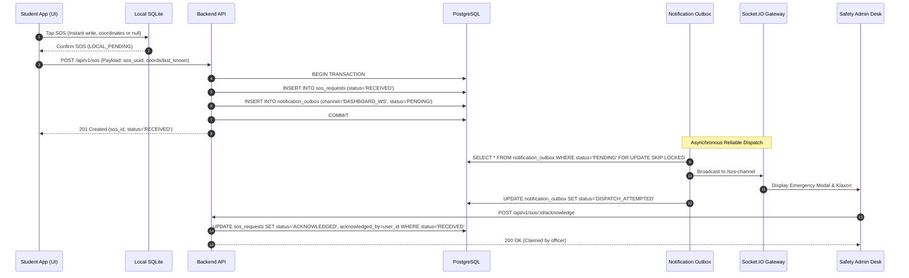

# CampusSafe: System Architecture & Technical Specifications

**Document Version:** 1.0.0  
**Status:** Approved Architectural Blueprint (Pre-Implementation)  
**System Class:** Distributed Offline-First Mobile & Web Safety Platform  
**Specification Status:** Ready for Phase 2 implementation  

---

## 1. System Topography & Monorepo Structure

To minimize operational complexity, maintain atomic versioning, and avoid disruptive mobile rewrites, CampusSafe utilizes an incremental multi-tier repository layout. The existing React Native CLI mobile application is preserved at the repository root, while dedicated directories are introduced for the backend service and the administrative web console:

```text
OfflineStudentTrackingProject/
├── android/                     # Existing React Native Android project (Target SDK 36, New Arch)
├── ios/                         # Existing React Native iOS project (New Arch, Hermes)
├── src/                         # Existing React Native mobile source (JavaScript)
│   ├── components/              # Mobile UI components (StatusCard, GeofenceBadge, SOSButton, etc.)
│   ├── constants/               # Color tokens, API constants, geofence fallbacks
│   ├── navigation/              # Navigation container & auth/session stacks
│   ├── screens/                 # Student mobile screens (SafetyDesk, SOSScreen, History, Settings)
│   ├── services/                # [Proposed] SQLite service, LocationWatcher, SyncWorker, SocketService
│   ├── state/                   # [Proposed] Redux Toolkit store (auth, session, syncStatus)
│   ├── styles/                  # Modular StyleSheet files (Zero inline styles)
│   └── utils/                   # Distance math, date formatters, geo-helpers
├── backend/                     # [Proposed Phase 2] Node.js + TypeScript REST & WebSocket API
│   ├── src/
│   │   ├── config/              # Environment variables, PostGIS database connection, JWT keys
│   │   ├── controllers/         # REST API endpoints (Auth, Campuses, Sessions, Sync, SOS, Audit)
│   │   ├── middleware/          # JWT authentication, role guards (STUDENT, GUARDIAN, ADMIN), campus checks
│   │   ├── models/              # Relational database schemas & PostGIS query builders
│   │   ├── services/            # Geofence engine, schedule validator, sync processor, outbox worker
│   │   ├── sockets/             # Socket.IO gateway, room management, SOS broadcasting
│   │   └── workers/             # Scheduled cron tasks (session schedule expiry, retention purge)
│   ├── package.json             # Backend dependencies (express, pg, socket.io, zod, etc.)
│   └── tsconfig.json
├── admin/                       # [Proposed Phase 4] React + TypeScript Administrative Web Dashboard
│   ├── src/
│   │   ├── components/          # Dashboard cards, live student list, SOS modal, map canvas
│   │   ├── maps/                # Leaflet / MapLibre PostGIS MultiPolygon renderer & live pins
│   │   ├── services/            # Admin REST API client & Socket.IO listener
│   │   ├── store/               # Admin dashboard UI state
│   │   └── pages/               # LiveMonitorPage, GeofenceEditorPage, IncidentLogPage, AuditPage
│   ├── package.json             # Admin web dependencies (vite, react, leaflet, socket.io-client)
│   └── vite.config.ts
├── shared/                      # [Proposed] Shared TypeScript interfaces & API contract types
│   └── types/
└── docs/                        # Architecture, data model, audit, and implementation specs
```

---

## 2. High-Level System Architecture Diagram

```mermaid
graph TB
    subgraph Mobile Device ["Mobile Client (React Native CLI 0.87.1)"]
        GPS["FusedLocationProvider\n(Hardware GPS / Network)"]
        LW["Location Watcher Service\n(Foreground Service + Notif)"]
        LDB[("Local SQLite Database\n(@op-engineering/op-sqlite)")]
        SyncQ["Offline Upload Queue\n(Batching & Retry Worker)"]
        SOS_M["SOS Trigger Controller\n(Immediate Local Persist)"]
        SecStore["Platform Secure Storage\n(EncryptedSharedPreferences / Keychain)"]
        UI["React Native UI\n(Safety Desk, SOS, MapView)"]
        Redux["Redux Toolkit\n(Session & UI State)"]
        
        GPS -->|Position Fix| LW
        LW -->|Insert Point (PENDING)| LDB
        LW -->|Local Proximity Check| UI
        SOS_M -->|Persist SOS (LOCAL_PENDING)| LDB
        UI -->|User Actions / SOS| SOS_M
        UI -->|State Updates| Redux
        SecStore -->|Auth Tokens| SyncQ
        SyncQ -->|Read Unsynced Batches| LDB
    end

    subgraph Backend Cloud ["CampusSafe Backend Service (Node.js + TypeScript)"]
        API["REST API Gateway\n(Express + Zod Validations)"]
        AuthM["Auth & RBAC Middleware\n(JWT, Campus Assignment/Membership)"]
        SocketGW["Socket.IO Gateway\n(Real-Time Namespace Cluster)"]
        GeoEngine["Spatial Geofence Engine\n(PostGIS MultiPolygon & Buffer Logic)"]
        SchedEngine["Schedule & Timezone Gate\n(College Hours Validator)"]
        OutboxWorker["Transactional Outbox Worker\n(SOS & Notification Dispatch)"]
        AuditEngine["Access Audit Logger\n(Append-Only Security Log)"]
        CronWorker["Background Cron Worker\n(Schedule Expiry & Retention)"]
        
        API --> AuthM
        AuthM --> GeoEngine
        AuthM --> SchedEngine
        AuthM --> AuditEngine
        SocketGW --> AuditEngine
    end

    subgraph Data Tier ["Authoritative Data Store"]
        Postgres[("PostgreSQL 16 + PostGIS\n- MultiPolygons & Point Geometries\n- Campus Memberships & Assignments\n- Refresh Tokens (Hashed)\n- Breadcrumbs & Current Locations\n- SOS Incidents & Notification Outbox\n- Append-Only Access Audit Logs")]
    end

    subgraph Web Console ["Administrative Control Desk (React + Vite)"]
        AdminMap["Live PostGIS Campus Map\n(Leaflet / MapLibre)"]
        SOSDesk["Emergency SOS Monitor\n(Audio Klaxon & Dispatch)"]
        AdminAudit["Audit Trail Inspector"]
    end

    SyncQ -->|HTTPS Idempotent Batch Upload| API
    SOS_M -->|Urgent SOS HTTP Post| API
    API -->|Read / Write Transactions| Postgres
    GeoEngine -->|ST_Contains / ST_Buffer| Postgres
    OutboxWorker -->|Poll & Dispatch| SocketGW
    CronWorker -->|Sweep & Expire by Schedule| Postgres
    SocketGW -->|WebSocket Live Stream| AdminMap
    SocketGW -->|Emergency Broadcast| SOSDesk
    API -->|Audit Queries| AdminAudit
```

---

## 3. Offline-First Sessions & Synchronization Pipeline

### 3.1 Offline Sessions vs. Server Freshness Decoupling
A foundational architectural principle of CampusSafe is that **server connectivity status does not govern safety session lifecycle**:
- **No Inactivity Expiry:** Sessions are **never** auto-expired simply because no telemetry has been received for 30 minutes. An offline phone in a basement or network dead zone continues recording fixes locally.
- **Session End Triggers:** A session only terminates when:
  1. The student explicitly taps **"Stop Safety Session"** on the mobile app.
  2. The configured campus operating hours conclude in the campus timezone (e.g. 17:30 IST), at which point both the server and the local device enforce schedule expiration.
  3. A safety administrator terminates the session due to a verified incident resolution.
- **Server Freshness Classification:** The server classifies location contact independently:
  - `FRESH`: Telemetry received with $(\text{now} - \text{captured\_at}) \le 120\text{ seconds}$.
  - `STALE`: $(\text{now} - \text{captured\_at})$ between 2 and 15 minutes.
  - `UNKNOWN`: No telemetry received for $> 15\text{ minutes}$ or connection dropped. The dashboard clearly marks the student as *Offline / Unreachable*, showing the last-known fix without corrupting session status.

### 3.2 Connectivity Requirement for New Sessions (MVP)
For the MVP, initiating a **new** safety session requires network connectivity. This allows the backend to:
1. Verify student-campus membership in `student_campus_memberships`.
2. Verify that current time falls within active campus schedule hours.
3. Validate and sync the current `boundary_version`.
4. Issue an authoritative `session_id` and signed session lease.
Once initiated, the session is fully offline-resilient until its scheduled conclusion.

### 3.3 Delayed Upload Acceptance
When an offline phone regains connectivity:
- The server accepts buffered location batches even if the session has already transitioned to `ENDED` or `EXPIRED`.
- Points with `captured_at` timestamps falling within the valid, consented session interval are inserted into `location_records`.
- Delayed uploads populate historical incident audit logs; they **do not** re-open the ended session or stream to guardians whose consent was subsequently revoked.

---

## 4. Location Identity, Deduplication & Atomic Latest-Location Updates

### 4.1 Client Point UUID & Conflict Handling Matrix
Every location fix carries a client-generated `point_uuid` (UUIDv4) and a monotonically increasing `seq_no` per session. The backend resolves idempotency and payload conflicts using a strict matrix:

| Scenario | Server Action | Response Status | Client Queue Action |
| :--- | :--- | :---: | :--- |
| **New Point** (New `point_uuid`, new `seq_no`) | Insert into `location_records`. | `ACCEPTED` (200) | Mark `SYNCED`, safe to prune per retention policy. |
| **Exact Duplicate** (Existing `point_uuid`, identical payload hash) | No-op. Idempotent acknowledgment. | `DUPLICATE` (200) | Mark `SYNCED`, prune per retention policy. |
| **Conflicting Point UUID** (Existing `point_uuid`, different payload) | Reject write. Flag data anomaly. | `REJECTED` (`PAYLOAD_CONFLICT`, 409) | Quarantine record; do not retry indefinitely. |
| **Conflicting Sequence** (Same `session_id` + `seq_no`, different `point_uuid`) | Reject write. Flag sequence violation. | `REJECTED` (`SEQUENCE_CONFLICT`, 409) | Quarantine record; flag device anomaly. |

### 4.2 Single Device & Single Active Session Enforcement
To prevent conflicting telemetry feeds:
1. Every safety session is bound to a specific client `device_id`.
2. The server enforces a partial unique constraint: exactly **one active safety session per student** across the system:
   ```sql
   CREATE UNIQUE INDEX uq_student_active_session 
   ON safety_sessions(student_id) 
   WHERE status = 'ACTIVE';
   ```
3. If a student attempts to start a second session on a different device, the request is rejected with `409 Conflict` until the prior session is ended.

### 4.3 Atomic Upsert for Latest Location (Across Sessions & Devices)
To ensure delayed historical uploads from a previous session cannot overwrite the latest coordinates of an active or newer session, `student_current_locations` tracks `session_started_at` alongside `captured_at` and `seq_no`. 

The upsert enforces strict session precedence:
1. Telemetry from a **newer session** (`EXCLUDED.session_started_at > student_current_locations.session_started_at`) always establishes or updates the latest location.
2. Telemetry from an **older or ended session** (`EXCLUDED.session_started_at < student_current_locations.session_started_at`) is inserted into `location_records` but is **prohibited** from altering `student_current_locations`.
3. Within the **same session**, a point updates the latest location if `EXCLUDED.captured_at > current.captured_at`, or if equal, `EXCLUDED.seq_no > current.seq_no`.

```sql
INSERT INTO student_current_locations (
    student_id, session_id, session_started_at, device_id, last_point_id,
    latitude, longitude, accuracy, speed, heading, is_inside_campus, campus_id,
    captured_at, received_at, freshness_status, seq_no, updated_at
) VALUES (
    $student_id, $session_id, $session_started_at, $device_id, $point_id,
    $latitude, $longitude, $accuracy, $speed, $heading, $is_inside, $campus_id,
    $captured_at, CURRENT_TIMESTAMP, $freshness_status, $seq_no, CURRENT_TIMESTAMP
)
ON CONFLICT (student_id) DO UPDATE SET
    session_id = EXCLUDED.session_id,
    session_started_at = EXCLUDED.session_started_at,
    device_id = EXCLUDED.device_id,
    last_point_id = EXCLUDED.last_point_id,
    latitude = EXCLUDED.latitude,
    longitude = EXCLUDED.longitude,
    accuracy = EXCLUDED.accuracy,
    speed = EXCLUDED.speed,
    heading = EXCLUDED.heading,
    is_inside_campus = EXCLUDED.is_inside_campus,
    campus_id = EXCLUDED.campus_id,
    captured_at = EXCLUDED.captured_at,
    received_at = CURRENT_TIMESTAMP,
    freshness_status = EXCLUDED.freshness_status,
    seq_no = EXCLUDED.seq_no,
    updated_at = CURRENT_TIMESTAMP
WHERE (
    -- Rule 1: A newer session takes absolute precedence over an older session
    EXCLUDED.session_started_at > student_current_locations.session_started_at
) OR (
    -- Rule 2: Within the same session, chronological ordering takes precedence
    EXCLUDED.session_id = student_current_locations.session_id
    AND (
        EXCLUDED.captured_at > student_current_locations.captured_at
        OR (EXCLUDED.captured_at = student_current_locations.captured_at AND EXCLUDED.seq_no > student_current_locations.seq_no)
    )
);
```

### 4.4 Timestamp Validation & Clock-Skew Handling
- Device timestamps (`captured_at`) are generated by client hardware and cannot be assumed to prove physical ground truth.
- **Validation Checks & Skew Handling:**
  1. **Future Threshold:** `captured_at` cannot be more than 5 minutes in the future relative to server `received_at`. Violations reject the point (`INVALID_TIMESTAMP_FUTURE`, 422).
  2. **Session Start Floor:** `captured_at` cannot be older than the session's `started_at` timestamp minus a 60-second grace window (`INVALID_TIMESTAMP_PAST`, 422).
  3. **Closed Session Window:** For an ended or expired session, delayed points must not exceed `ended_at` plus a 60-second grace window (`INVALID_TIMESTAMP_POST_SESSION`, 422).
- The server records `received_at` on every record to maintain authoritative audit timelines.

---

## 5. Offline Queue Protocol on Mobile

The mobile client manages the upload queue in local SQLite with transactional guarantees:

1. **Atomic Insertion & Sequence Allocation:**
   - Every location fix is inserted inside an immediate SQLite transaction (`BEGIN IMMEDIATE`):
     ```sql
     INSERT INTO location_queue (
       point_uuid, session_id, seq_no, user_id, latitude, longitude,
       accuracy, speed, heading, is_mock, captured_at, sync_status
     ) VALUES (?, ?, (SELECT COALESCE(MAX(seq_no), 0) + 1 FROM location_queue WHERE session_id = ?), ?, ?, ?, ?, ?, ?, ?, ?, 'PENDING');
     ```
2. **Per-Point Sync Acknowledgement:**
   - The sync worker sends batches of up to 25 points to `POST /api/v1/sessions/:id/locations/batch`.
   - Records are transitioned from `PENDING` to `SYNCING` before dispatch.
   - The worker parses the server's per-point `results` array. **Only** records explicitly confirmed as `ACCEPTED` or `DUPLICATE` are marked `SYNCED`.
   - Records marked `REJECTED` with `retryable = false` are moved to a local `quarantine` table to prevent infinite upload retry loops.
3. **Crash Recovery for Interrupted Syncs:**
   - When the app launches or restarts, a startup reconciliation routine resets any stranded records:
     ```sql
     UPDATE location_queue SET sync_status = 'PENDING' WHERE sync_status = 'SYNCING';
     ```
4. **Bounded Storage & Storage-Pressure Policy:**
   - The upload queue is bounded to a maximum of **10,000 points** (~1.5 MB of SQLite storage).
   - **No Silent Purging:** Unacknowledged location records are **never** silently deleted when the queue reaches capacity.
   - **Recorded Data Gaps:** If storage pressure forces truncation of routine breadcrumbs, the client writes a structured `TELEMETRY_GAP_RECORDED` event to `local_events_queue` documenting the gap window (`gap_start`, `gap_end`, `dropped_count`).
   - **Critical Event Protection:** Emergency SOS records (`local_sos_queue`) and safety events (`local_events_queue`) are stored in isolated, protected tables and are **never** dropped under storage pressure.
   - **Student Alert:** The mobile app displays an explicit, persistent warning banner: *"Local storage full: Offline location logging paused to preserve critical safety events. Connect to network to synchronize."*
5. **Account-Switch & Logout Isolation:**
   - All rows in `location_queue` and `local_sessions` carry `user_id`.
   - When a user logs out, unsynced telemetry belonging to that user is securely wiped or isolated, preventing cross-user data leakage.
6. **Local Retention for Student History:**
   - Records are **not** deleted immediately upon receiving HTTP 200. Uploaded records remain in SQLite with `sync_status = 'SYNCED'` for **7 days** to populate the student's on-device History screen, after which a local cleanup worker compacts the database.

---

## 6. Geofence & MultiPolygon Boundary Engine

### 6.1 MultiPolygon Topology & Boundary Versioning
- Campus boundaries are represented as PostGIS MultiPolygons (`GEOMETRY(MultiPolygon, 4326)`).
- Every campus defines a `boundary_version` integer. When campus boundaries are adjusted in the admin console, the version increments.
- Historical breadcrumbs preserve the `boundary_version` active at the time of capture, ensuring historical playback accurately reflects the historical perimeter.

### 6.2 Deterministic Dwell & Exit Evaluation
To eliminate boundary false alarms caused by GPS drift near fence lines:
- **Buffer Zone:** A 20-meter perimeter buffer is generated using `ST_Buffer(campus.boundary::geography, 20)::geometry`.
- **Exit Trigger Requirements:** A `CAMPUS_EXIT` event is generated if and only if all four conditions are met:
  1. `min_dwell_duration_seconds`: Device has been continuously observed outside core and buffer for at least **45 seconds**.
  2. `min_consecutive_observations`: At least **3 consecutive valid fixes** observe the device outside.
  3. `max_accuracy_threshold`: Each observation must have accuracy $\le 50.0\text{ meters}$.
  4. `max_observation_gap_seconds`: Time gap between consecutive observations must be $\le 30\text{ seconds}$. If signal is lost or app pauses for $> 30\text{s}$, the dwell timer resets. Missing intervals never count as dwell time.

---

## 7. Emergency SOS Reliability & Outbox Architecture



1. **Immediate Local Persistence:** The mobile app persists the SOS event into `local_sos_queue` immediately upon user trigger with status `LOCAL_PENDING`, without awaiting a GPS lock.
2. **Out-of-Session Routing & No Silent Tracking:** If triggered outside an active safety session or college hours, the SOS is routed to safety administrators assigned to the student's primary enrolled campus (`student_campus_memberships`) and active guardians. It transmits a point-in-time snapshot and does **not** silently start continuous tracking.
3. **Transactional Outbox & Evidenced Delivery:** The backend writes the SOS record with status `RECEIVED` and notification jobs into `notification_outbox` within a single atomic database transaction. Notification dispatch attempts (`DISPATCH_ATTEMPTED`) and evidenced recipient confirmations (`RECIPIENT_CONFIRMED`) are tracked separately; WebSocket emission or mock logging is never treated as confirmed delivery.
4. **Concurrency-Safe Claim:** Multiple security guards cannot claim the same SOS simultaneously. An atomic SQL update ensures only the first guard claiming the incident succeeds:
   ```sql
   UPDATE sos_requests 
   SET status = 'ACKNOWLEDGED', acknowledged_by_user_id = $admin_id, acknowledged_at = CURRENT_TIMESTAMP
   WHERE id = $sos_id AND status = 'RECEIVED'
   RETURNING *;
   ```
5. **Reconnecting Admin Recovery:** Reconnecting admin consoles query `GET /api/v1/sos/active?campusId=...` to retrieve any active, unacknowledged incidents (`status = 'RECEIVED'`) missed during network disconnection.

---

## 8. Threat Model & Security Posture

| Threat | Attack Vector | Mitigation in CampusSafe Architecture |
| :--- | :--- | :--- |
| **Unauthorized Surveillance** | Rogue admin or stalker accessing live student locations. | 1. Campus assignment check: Admin must be assigned to student's campus.<br>2. Active session + student consent grant required.<br>3. Append-only `access_audit_logs` record every view event. |
| **GPS Coordinate Spoofing** | Student uses mock location apps (Fake GPS) to fake attendance or safety status. | 1. Detection via native Android API: `Location.isFromMockProvider()`.<br>2. Points flagged with `is_mock = true` are visually highlighted on the admin console and barred from safety verification.<br>3. Teleportation anomaly checks: speed $> 150\text{ km/h}$ flagged as suspicious. |
| **Abandoned Safety Sessions** | Student activates safety session and forgets to end it, or battery dies. | 1. Schedule auto-expiry: Sessions auto-expire when campus operating hours end.<br>2. Offline session continues until local schedule end or manual stop.<br>3. Disconnected status flagged as `UNKNOWN` on dashboard. |
| **Revoked Guardian Snooping** | Revoked contact attempts to inspect student movements. | 1. Immediate link revocation: Socket room subscription severed immediately.<br>2. Server drops guardian requests at API gateway.<br>3. Zero classmate discovery APIs exist in the system. |
| **Credential Theft via Device Extraction** | Attacker extracts tokens from unencrypted storage on device. | 1. Deprecate AsyncStorage for auth credentials.<br>2. Platform secure storage (`EncryptedSharedPreferences` / Keychain) for refresh tokens.<br>3. Token family rotation and replay detection in backend. |
| **Audit Log Tampering** | Malicious insider attempts to delete access history. | 1. Database-level `REVOKE UPDATE, DELETE ON access_audit_logs FROM campussafe_app`.<br>2. Dedicated append-only application user role. |
