# CampusSafe: Data Models, Relational Schema & State Specifications

**Document Version:** 1.0.0  
**Target RDBMS:** PostgreSQL 16+ with PostGIS 3.4+ Extension  
**Target Mobile RDBMS:** SQLite 3 (via `@op-engineering/op-sqlite`)  
**Specification Status:** Ready for Phase 2 implementation  

---

## 1. Relational Entity Relationship Diagram (ERD)

```mermaid
erDiagram
    USERS ||--o{ STUDENT_CAMPUS_MEMBERSHIPS : "student_enrolled_in"
    CAMPUSES ||--o{ STUDENT_CAMPUS_MEMBERSHIPS : "enrolls_student"
    USERS ||--o{ ADMIN_CAMPUS_ASSIGNMENTS : "admin_assigned_to"
    CAMPUSES ||--o{ ADMIN_CAMPUS_ASSIGNMENTS : "assigns_admin"
    USERS ||--o{ REFRESH_TOKENS : "owns_tokens"
    USERS ||--o{ SAFETY_SESSIONS : "student_initiates"
    USERS ||--o{ GUARDIAN_LINKS : "student_owns / guardian_accepts"
    USERS ||--o{ GUARDIAN_CONSENT_EVENTS : "student_grants_revokes"
    USERS ||--o{ ACCESS_AUDIT_LOGS : "performed_by / targets"
    USERS ||--o{ SOS_REQUESTS : "student_triggers / admin_acknowledges"
    CAMPUSES ||--o{ MONITORING_SCHEDULES : "governs"
    CAMPUSES ||--o{ SAFETY_SESSIONS : "bounds"
    SAFETY_SESSIONS ||--o{ LOCATION_RECORDS : "contains_breadcrumbs"
    SAFETY_SESSIONS ||--o{ SAFETY_EVENTS : "records_events"
    SAFETY_SESSIONS ||--o{ SOS_REQUESTS : "spawns_emergency"
    SOS_REQUESTS ||--o{ NOTIFICATION_OUTBOX : "triggers_notifications"
    USERS ||--o| STUDENT_CURRENT_LOCATIONS : "has_one_latest"

    USERS {
        uuid id PK
        varchar email UK
        varchar phone UK
        varchar role "STUDENT | GUARDIAN | UNIVERSITY_SAFETY_ADMIN"
        varchar password_hash
        varchar full_name
        varchar roll_number
        boolean is_active
        timestamptz created_at
    }

    STUDENT_CAMPUS_MEMBERSHIPS {
        uuid id PK
        uuid student_id FK
        uuid campus_id FK
        boolean is_active
        timestamptz enrolled_at
    }

    ADMIN_CAMPUS_ASSIGNMENTS {
        uuid id PK
        uuid admin_user_id FK
        uuid campus_id FK
        boolean can_manage_boundaries
        boolean can_handle_sos
        timestamptz assigned_at
    }

    REFRESH_TOKENS {
        uuid id PK
        uuid user_id FK
        varchar token_hash UK
        uuid family_id
        boolean is_revoked
        timestamptz expires_at
        timestamptz created_at
        timestamptz revoked_at
    }

    CAMPUSES {
        uuid id PK
        varchar name
        varchar code UK
        geometry boundary "MultiPolygon SRID 4326"
        int boundary_version
        double center_latitude
        double center_longitude
        varchar timezone "e.g. Asia/Kolkata"
        int buffer_meters
        boolean is_active
    }

    MONITORING_SCHEDULES {
        uuid id PK
        uuid campus_id FK
        smallint day_of_week "0=Sun, 6=Sat"
        time start_time
        time end_time
        boolean is_active
    }

    GUARDIAN_LINKS {
        uuid id PK
        uuid student_id FK
        uuid guardian_id FK
        varchar invitation_token_hash UK
        varchar status "PENDING | ACCEPTED | EXPIRED | REVOKED"
        boolean consent_granted
        timestamptz token_expiry
        timestamptz invited_at
        timestamptz accepted_at
        timestamptz revoked_at
    }

    GUARDIAN_CONSENT_EVENTS {
        uuid id PK
        uuid student_id FK
        uuid guardian_id FK
        varchar action "GRANT | REVOKE"
        varchar scope "LINK_LEVEL | SESSION_LEVEL"
        uuid session_id FK
        timestamptz occurred_at
    }

    SAFETY_SESSIONS {
        uuid id PK
        uuid student_id FK
        uuid campus_id FK
        int boundary_version
        varchar device_id
        varchar status "ACTIVE | ENDED | EXPIRED"
        boolean consent_university
        boolean consent_guardians
        timestamptz started_at
        timestamptz ended_at
        timestamptz expires_at
        varchar end_reason "USER_STOPPED | SCHEDULE_ENDED | EMERGENCY_OVERRIDE | ADMIN_TERMINATED"
    }

    LOCATION_RECORDS {
        uuid id PK
        uuid point_uuid UK
        uuid session_id FK
        uuid student_id FK
        bigint seq_no
        geometry coordinates "Point SRID 4326"
        double latitude
        double longitude
        float accuracy
        float speed
        float heading
        boolean is_mock
        varchar payload_hash
        int boundary_version
        varchar accuracy_quality "HIGH | MEDIUM | DEGRADED"
        timestamptz captured_at
        timestamptz received_at
        uuid sync_batch_id
    }

    STUDENT_CURRENT_LOCATIONS {
        uuid student_id PK, FK
        uuid session_id FK
        uuid last_point_id FK
        varchar device_id
        bigint seq_no
        double latitude
        double longitude
        float accuracy
        boolean is_inside_campus
        uuid campus_id FK
        timestamptz captured_at
        timestamptz received_at
        varchar freshness_status "FRESH | STALE | UNKNOWN"
        timestamptz updated_at
    }

    SAFETY_EVENTS {
        uuid id PK
        uuid session_id FK
        uuid student_id FK
        varchar event_type "SESSION_START | CAMPUS_EXIT | BUFFER_WARNING | SOS_TRIGGER"
        jsonb metadata
        timestamptz triggered_at
        timestamptz created_at
    }

    SOS_REQUESTS {
        uuid id PK
        uuid sos_uuid UK
        uuid session_id FK
        uuid student_id FK
        varchar status "LOCAL_PENDING | DELIVERED | ACKNOWLEDGED | RESOLVED"
        boolean has_coordinates
        boolean is_last_known
        double initial_latitude
        double initial_longitude
        float initial_accuracy
        timestamptz last_known_captured_at
        timestamptz triggered_at
        timestamptz delivered_at
        timestamptz acknowledged_at
        uuid acknowledged_by_user_id FK
        text resolution_notes
        timestamptz resolved_at
    }

    NOTIFICATION_OUTBOX {
        uuid id PK
        uuid sos_id FK
        varchar channel "DASHBOARD_WS | GUARDIAN_WS | SMS_MOCK"
        uuid recipient_id
        jsonb payload
        varchar status "PENDING | DISPATCHED | FAILED"
        int retry_count
        timestamptz created_at
        timestamptz dispatched_at
    }

    ACCESS_AUDIT_LOGS {
        uuid id PK
        uuid actor_user_id FK
        varchar actor_role
        uuid target_student_id FK
        varchar action "LIVE_VIEW | HISTORY_VIEW | SOS_DISPATCH"
        inet ip_address
        text user_agent
        timestamptz accessed_at
    }
```



---

## 2. PostgreSQL + PostGIS Schema Definition (DDL)

```sql
-- Enable PostGIS and UUID extensions
CREATE EXTENSION IF NOT EXISTS "uuid-ossp";
CREATE EXTENSION IF NOT EXISTS postgis;

-- 1. User Accounts & RBAC
CREATE TYPE user_role_enum AS ENUM ('STUDENT', 'GUARDIAN', 'UNIVERSITY_SAFETY_ADMIN');

CREATE TABLE users (
    id UUID PRIMARY KEY DEFAULT uuid_generate_v4(),
    email VARCHAR(255) NOT NULL UNIQUE,
    phone VARCHAR(32) NOT NULL UNIQUE,
    role user_role_enum NOT NULL,
    password_hash VARCHAR(255) NOT NULL,
    full_name VARCHAR(255) NOT NULL,
    roll_number VARCHAR(64),
    is_active BOOLEAN NOT NULL DEFAULT TRUE,
    created_at TIMESTAMPTZ NOT NULL DEFAULT CURRENT_TIMESTAMP,
    updated_at TIMESTAMPTZ NOT NULL DEFAULT CURRENT_TIMESTAMP
);

CREATE INDEX idx_users_role ON users(role);

-- 2. Refresh Token Persistence with Token Family Rotation
CREATE TABLE refresh_tokens (
    id UUID PRIMARY KEY DEFAULT uuid_generate_v4(),
    user_id UUID NOT NULL REFERENCES users(id) ON DELETE CASCADE,
    token_hash VARCHAR(255) NOT NULL UNIQUE,
    family_id UUID NOT NULL,
    is_revoked BOOLEAN NOT NULL DEFAULT FALSE,
    expires_at TIMESTAMPTZ NOT NULL,
    created_at TIMESTAMPTZ NOT NULL DEFAULT CURRENT_TIMESTAMP,
    revoked_at TIMESTAMPTZ
);

CREATE INDEX idx_refresh_tokens_family ON refresh_tokens(family_id);
CREATE INDEX idx_refresh_tokens_user ON refresh_tokens(user_id);

-- 3. Campus Entities & MultiPolygon Geofence
CREATE TABLE campuses (
    id UUID PRIMARY KEY DEFAULT uuid_generate_v4(),
    name VARCHAR(255) NOT NULL,
    code VARCHAR(32) NOT NULL UNIQUE,
    boundary GEOMETRY(MultiPolygon, 4326) NOT NULL,
    boundary_version INTEGER NOT NULL DEFAULT 1,
    center_latitude DOUBLE PRECISION NOT NULL,
    center_longitude DOUBLE PRECISION NOT NULL,
    timezone VARCHAR(64) NOT NULL DEFAULT 'Asia/Kolkata',
    buffer_meters INTEGER NOT NULL DEFAULT 20,
    is_active BOOLEAN NOT NULL DEFAULT TRUE,
    created_at TIMESTAMPTZ NOT NULL DEFAULT CURRENT_TIMESTAMP,
    updated_at TIMESTAMPTZ NOT NULL DEFAULT CURRENT_TIMESTAMP
);

CREATE INDEX idx_campuses_boundary_gist ON campuses USING GIST(boundary);

-- 4. Student-Campus Membership & Safety Admin Campus Assignment
CREATE TABLE student_campus_memberships (
    id UUID PRIMARY KEY DEFAULT uuid_generate_v4(),
    student_id UUID NOT NULL REFERENCES users(id) ON DELETE CASCADE,
    campus_id UUID NOT NULL REFERENCES campuses(id) ON DELETE CASCADE,
    status VARCHAR(32) NOT NULL DEFAULT 'PENDING_APPROVAL' CHECK (status IN ('PENDING_APPROVAL', 'VERIFIED', 'REVOKED')),
    is_active BOOLEAN NOT NULL DEFAULT TRUE,
    enrolled_at TIMESTAMPTZ NOT NULL DEFAULT CURRENT_TIMESTAMP,
    verified_by UUID REFERENCES users(id),
    verified_at TIMESTAMPTZ,
    CONSTRAINT uq_student_campus UNIQUE (student_id, campus_id)
);

CREATE INDEX idx_student_memberships ON student_campus_memberships(student_id, is_active, status);

CREATE TABLE admin_campus_assignments (
    id UUID PRIMARY KEY DEFAULT uuid_generate_v4(),
    admin_user_id UUID NOT NULL REFERENCES users(id) ON DELETE CASCADE,
    campus_id UUID NOT NULL REFERENCES campuses(id) ON DELETE CASCADE,
    can_manage_boundaries BOOLEAN NOT NULL DEFAULT FALSE,
    can_handle_sos BOOLEAN NOT NULL DEFAULT TRUE,
    assigned_at TIMESTAMPTZ NOT NULL DEFAULT CURRENT_TIMESTAMP,
    CONSTRAINT uq_admin_campus UNIQUE (admin_user_id, campus_id)
);

CREATE INDEX idx_admin_assignments ON admin_campus_assignments(admin_user_id, campus_id);

-- 5. Monitoring Operating Schedules (Campus Timezone)
CREATE TABLE monitoring_schedules (
    id UUID PRIMARY KEY DEFAULT uuid_generate_v4(),
    campus_id UUID NOT NULL REFERENCES campuses(id) ON DELETE CASCADE,
    day_of_week SMALLINT NOT NULL CHECK (day_of_week BETWEEN 0 AND 6), -- 0 = Sunday
    start_time TIME NOT NULL,
    end_time TIME NOT NULL,
    is_active BOOLEAN NOT NULL DEFAULT TRUE,
    CONSTRAINT chk_schedule_time_order CHECK (start_time < end_time)
);

CREATE INDEX idx_schedules_campus_day ON monitoring_schedules(campus_id, day_of_week);

-- 6. Student-Guardian Linkages & Consent Tracking
CREATE TYPE guardian_link_status_enum AS ENUM ('PENDING', 'ACCEPTED', 'EXPIRED', 'REVOKED');

CREATE TABLE guardian_links (
    id UUID PRIMARY KEY DEFAULT uuid_generate_v4(),
    student_id UUID NOT NULL REFERENCES users(id) ON DELETE CASCADE,
    guardian_id UUID REFERENCES users(id) ON DELETE SET NULL,
    invitation_token_hash VARCHAR(255) NOT NULL UNIQUE,
    status guardian_link_status_enum NOT NULL DEFAULT 'PENDING',
    consent_granted BOOLEAN NOT NULL DEFAULT FALSE,
    token_expiry TIMESTAMPTZ NOT NULL,
    invited_at TIMESTAMPTZ NOT NULL DEFAULT CURRENT_TIMESTAMP,
    accepted_at TIMESTAMPTZ,
    consumed_at TIMESTAMPTZ,
    revoked_at TIMESTAMPTZ,
    CONSTRAINT chk_student_differs_guardian CHECK (student_id != guardian_id)
);

CREATE INDEX idx_guardian_links_student ON guardian_links(student_id);
CREATE INDEX idx_guardian_links_guardian ON guardian_links(guardian_id);

CREATE TABLE guardian_consent_events (
    id UUID PRIMARY KEY DEFAULT uuid_generate_v4(),
    student_id UUID NOT NULL REFERENCES users(id) ON DELETE CASCADE,
    guardian_id UUID REFERENCES users(id) ON DELETE CASCADE,
    action VARCHAR(16) NOT NULL CHECK (action IN ('GRANT', 'REVOKE')),
    scope VARCHAR(16) NOT NULL CHECK (scope IN ('LINK_LEVEL', 'SESSION_LEVEL')),
    session_id UUID,
    occurred_at TIMESTAMPTZ NOT NULL DEFAULT CURRENT_TIMESTAMP
);

CREATE INDEX idx_consent_events_student ON guardian_consent_events(student_id, occurred_at DESC);

-- 7. Explicit Safety Sessions (Consent-Driven)
CREATE TYPE session_status_enum AS ENUM ('ACTIVE', 'ENDED', 'EXPIRED');
CREATE TYPE session_end_reason_enum AS ENUM ('USER_STOPPED', 'SCHEDULE_ENDED', 'EMERGENCY_OVERRIDE', 'ADMIN_TERMINATED');

CREATE TABLE safety_sessions (
    id UUID PRIMARY KEY DEFAULT uuid_generate_v4(),
    student_id UUID NOT NULL REFERENCES users(id) ON DELETE CASCADE,
    campus_id UUID NOT NULL REFERENCES campuses(id) ON DELETE RESTRICT,
    boundary_version INTEGER NOT NULL DEFAULT 1,
    device_id VARCHAR(128) NOT NULL,
    status session_status_enum NOT NULL DEFAULT 'ACTIVE',
    consent_university BOOLEAN NOT NULL DEFAULT TRUE,
    consent_guardians BOOLEAN NOT NULL DEFAULT TRUE,
    started_at TIMESTAMPTZ NOT NULL DEFAULT CURRENT_TIMESTAMP,
    ended_at TIMESTAMPTZ,
    expires_at TIMESTAMPTZ NOT NULL,
    end_reason session_end_reason_enum
);

CREATE UNIQUE INDEX uq_student_active_session ON safety_sessions(student_id) WHERE status = 'ACTIVE';
CREATE INDEX idx_sessions_student_status ON safety_sessions(student_id, status);
CREATE INDEX idx_sessions_schedule_sweep ON safety_sessions(status, expires_at) WHERE status = 'ACTIVE';

-- 8. Location Telemetry Breadcrumbs (Append-Only Historical Log)
CREATE TYPE accuracy_quality_enum AS ENUM ('HIGH', 'MEDIUM', 'DEGRADED');

CREATE TABLE location_records (
    id UUID PRIMARY KEY DEFAULT uuid_generate_v4(),
    point_uuid UUID NOT NULL UNIQUE,
    session_id UUID NOT NULL REFERENCES safety_sessions(id) ON DELETE CASCADE,
    student_id UUID NOT NULL REFERENCES users(id) ON DELETE CASCADE,
    seq_no BIGINT NOT NULL,
    coordinates GEOMETRY(Point, 4326) NOT NULL,
    latitude DOUBLE PRECISION NOT NULL,
    longitude DOUBLE PRECISION NOT NULL,
    altitude DOUBLE PRECISION,
    accuracy REAL NOT NULL,
    speed REAL,
    heading REAL,
    is_mock BOOLEAN NOT NULL DEFAULT FALSE,
    payload_hash VARCHAR(64) NOT NULL,
    boundary_version INTEGER NOT NULL DEFAULT 1,
    accuracy_quality accuracy_quality_enum NOT NULL DEFAULT 'HIGH',
    captured_at TIMESTAMPTZ NOT NULL,
    received_at TIMESTAMPTZ NOT NULL DEFAULT CURRENT_TIMESTAMP,
    sync_batch_id UUID NOT NULL,
    CONSTRAINT uq_session_seq_no UNIQUE (session_id, seq_no)
);

CREATE INDEX idx_location_records_coords_gist ON location_records USING GIST(coordinates);
CREATE INDEX idx_location_records_student_time ON location_records(student_id, captured_at DESC);
CREATE INDEX idx_location_records_session_seq ON location_records(session_id, seq_no);

-- 9. Materialized Latest Position Table
CREATE TYPE freshness_status_enum AS ENUM ('FRESH', 'STALE', 'UNKNOWN');

CREATE TABLE student_current_locations (
    student_id UUID PRIMARY KEY REFERENCES users(id) ON DELETE CASCADE,
    session_id UUID NOT NULL REFERENCES safety_sessions(id) ON DELETE CASCADE,
    session_started_at TIMESTAMPTZ NOT NULL,
    last_point_id UUID REFERENCES location_records(id) ON DELETE SET NULL,
    device_id VARCHAR(128) NOT NULL,
    seq_no BIGINT NOT NULL DEFAULT 0,
    latitude DOUBLE PRECISION NOT NULL,
    longitude DOUBLE PRECISION NOT NULL,
    accuracy REAL NOT NULL,
    speed REAL,
    heading REAL,
    is_inside_campus BOOLEAN NOT NULL DEFAULT TRUE,
    campus_id UUID REFERENCES campuses(id) ON DELETE SET NULL,
    captured_at TIMESTAMPTZ NOT NULL,
    received_at TIMESTAMPTZ NOT NULL DEFAULT CURRENT_TIMESTAMP,
    freshness_status freshness_status_enum NOT NULL DEFAULT 'FRESH',
    updated_at TIMESTAMPTZ NOT NULL DEFAULT CURRENT_TIMESTAMP
);

CREATE INDEX idx_student_current_campus_inside ON student_current_locations(campus_id, is_inside_campus);

-- 10. Safety & Geofence Events
CREATE TYPE safety_event_type_enum AS ENUM (
    'SESSION_START', 'SESSION_END', 'CAMPUS_EXIT', 'CAMPUS_ENTER',
    'BUFFER_WARNING', 'MOCK_LOCATION_DETECTED', 'ACCURACY_DEGRADED'
);

CREATE TABLE safety_events (
    id UUID PRIMARY KEY DEFAULT uuid_generate_v4(),
    event_uuid UUID NOT NULL UNIQUE,
    session_id UUID NOT NULL REFERENCES safety_sessions(id) ON DELETE CASCADE,
    student_id UUID NOT NULL REFERENCES users(id) ON DELETE CASCADE,
    event_type safety_event_type_enum NOT NULL,
    metadata JSONB NOT NULL DEFAULT '{}',
    triggered_at TIMESTAMPTZ NOT NULL,
    created_at TIMESTAMPTZ NOT NULL DEFAULT CURRENT_TIMESTAMP
);

CREATE INDEX idx_safety_events_session ON safety_events(session_id, triggered_at DESC);

-- 11. Emergency SOS Incidents & Notification Outbox
CREATE TYPE sos_status_enum AS ENUM ('LOCAL_PENDING', 'RECEIVED', 'ACKNOWLEDGED', 'RESOLVED');

CREATE TABLE sos_requests (
    id UUID PRIMARY KEY DEFAULT uuid_generate_v4(),
    sos_uuid UUID NOT NULL UNIQUE,
    session_id UUID REFERENCES safety_sessions(id) ON DELETE SET NULL,
    student_id UUID NOT NULL REFERENCES users(id) ON DELETE CASCADE,
    campus_id UUID REFERENCES campuses(id) ON DELETE SET NULL,
    status sos_status_enum NOT NULL DEFAULT 'RECEIVED',
    has_coordinates BOOLEAN NOT NULL DEFAULT FALSE,
    is_last_known BOOLEAN NOT NULL DEFAULT FALSE,
    initial_latitude DOUBLE PRECISION,
    initial_longitude DOUBLE PRECISION,
    initial_accuracy REAL,
    last_known_captured_at TIMESTAMPTZ,
    triggered_at TIMESTAMPTZ NOT NULL DEFAULT CURRENT_TIMESTAMP,
    delivered_at TIMESTAMPTZ NOT NULL DEFAULT CURRENT_TIMESTAMP,
    acknowledged_at TIMESTAMPTZ,
    acknowledged_by_user_id UUID REFERENCES users(id) ON DELETE SET NULL,
    resolution_notes TEXT,
    resolved_at TIMESTAMPTZ
);

CREATE INDEX idx_sos_requests_status ON sos_requests(status, triggered_at DESC);
CREATE INDEX idx_sos_requests_campus ON sos_requests(campus_id, status);

CREATE TABLE notification_outbox (
    id UUID PRIMARY KEY DEFAULT uuid_generate_v4(),
    sos_id UUID NOT NULL REFERENCES sos_requests(id) ON DELETE CASCADE,
    channel VARCHAR(32) NOT NULL CHECK (channel IN ('DASHBOARD_WS', 'GUARDIAN_WS', 'SMS_MOCK')),
    recipient_id UUID,
    payload JSONB NOT NULL,
    status VARCHAR(32) NOT NULL DEFAULT 'PENDING' CHECK (status IN ('PENDING', 'DISPATCH_ATTEMPTED', 'RECIPIENT_CONFIRMED', 'FAILED')),
    retry_count INTEGER NOT NULL DEFAULT 0,
    created_at TIMESTAMPTZ NOT NULL DEFAULT CURRENT_TIMESTAMP,
    dispatched_at TIMESTAMPTZ,
    confirmed_at TIMESTAMPTZ,
    delivery_evidence JSONB
);

CREATE INDEX idx_notification_outbox_pending ON notification_outbox(status, created_at ASC) WHERE status IN ('PENDING', 'DISPATCH_ATTEMPTED');

-- 12. Append-Only Access Audit Log
CREATE TABLE access_audit_logs (
    id UUID PRIMARY KEY DEFAULT uuid_generate_v4(),
    actor_user_id UUID NOT NULL REFERENCES users(id) ON DELETE RESTRICT,
    actor_role user_role_enum NOT NULL,
    target_student_id UUID NOT NULL REFERENCES users(id) ON DELETE RESTRICT,
    campus_id UUID REFERENCES campuses(id) ON DELETE SET NULL,
    action VARCHAR(64) NOT NULL,
    ip_address INET NOT NULL,
    user_agent TEXT NOT NULL,
    accessed_at TIMESTAMPTZ NOT NULL DEFAULT CURRENT_TIMESTAMP
);

CREATE INDEX idx_audit_logs_target ON access_audit_logs(target_student_id, accessed_at DESC);
CREATE INDEX idx_audit_logs_actor ON access_audit_logs(actor_user_id, accessed_at DESC);
CREATE INDEX idx_audit_logs_campus ON access_audit_logs(campus_id, accessed_at DESC);
```

---

## 3. Mobile SQLite Schema (`@op-engineering/op-sqlite`)

```sql
-- 1. Active Session State
CREATE TABLE IF NOT EXISTS local_sessions (
    session_id TEXT PRIMARY KEY,
    user_id TEXT NOT NULL,
    campus_id TEXT NOT NULL,
    device_id TEXT NOT NULL,
    boundary_version INTEGER NOT NULL DEFAULT 1,
    status TEXT NOT NULL CHECK (status IN ('ACTIVE', 'ENDED', 'EXPIRED')),
    consent_university INTEGER NOT NULL DEFAULT 1,
    consent_guardians INTEGER NOT NULL DEFAULT 1,
    started_at TEXT NOT NULL,
    expires_at TEXT NOT NULL,
    next_seq_no INTEGER NOT NULL DEFAULT 1
);

-- 2. Offline Telemetry Upload Queue
CREATE TABLE IF NOT EXISTS location_queue (
    id INTEGER PRIMARY KEY AUTOINCREMENT,
    point_uuid TEXT NOT NULL UNIQUE,
    session_id TEXT NOT NULL,
    user_id TEXT NOT NULL,
    seq_no INTEGER NOT NULL,
    latitude REAL NOT NULL,
    longitude REAL NOT NULL,
    altitude REAL,
    accuracy REAL NOT NULL,
    speed REAL,
    heading REAL,
    is_mock INTEGER NOT NULL DEFAULT 0,
    payload_hash TEXT NOT NULL,
    captured_at TEXT NOT NULL,
    sync_status TEXT NOT NULL DEFAULT 'PENDING' CHECK (sync_status IN ('PENDING', 'SYNCING', 'SYNCED', 'FAILED')),
    retry_count INTEGER NOT NULL DEFAULT 0,
    last_error TEXT,
    created_at TEXT NOT NULL DEFAULT (datetime('now', 'utc')),
    synced_at TEXT
);

CREATE INDEX IF NOT EXISTS idx_location_queue_status_user 
ON location_queue(user_id, sync_status, seq_no ASC);

-- 3. Local Safety Events Queue
CREATE TABLE IF NOT EXISTS local_events_queue (
    event_uuid TEXT PRIMARY KEY,
    session_id TEXT NOT NULL,
    user_id TEXT NOT NULL,
    event_type TEXT NOT NULL,
    payload TEXT NOT NULL,
    captured_at TEXT NOT NULL,
    sync_status TEXT NOT NULL DEFAULT 'PENDING' CHECK (sync_status IN ('PENDING', 'SYNCING', 'SYNCED', 'FAILED'))
);

-- 4. Local Emergency SOS Queue (Highest Priority)
CREATE TABLE IF NOT EXISTS local_sos_queue (
    sos_uuid TEXT PRIMARY KEY,
    user_id TEXT NOT NULL,
    session_id TEXT,
    campus_id TEXT,
    has_coordinates INTEGER NOT NULL DEFAULT 0,
    is_last_known INTEGER NOT NULL DEFAULT 0,
    latitude REAL,
    longitude REAL,
    accuracy REAL,
    last_known_captured_at TEXT,
    triggered_at TEXT NOT NULL,
    sync_status TEXT NOT NULL DEFAULT 'PENDING' CHECK (sync_status IN ('PENDING', 'SYNCING', 'SYNCED', 'FAILED'))
);

-- 5. Key-Value Offline Configuration Store
CREATE TABLE IF NOT EXISTS offline_config (
    config_key TEXT PRIMARY KEY,
    config_value TEXT NOT NULL,
    updated_at TEXT NOT NULL DEFAULT (datetime('now', 'utc'))
);
```

---

## 4. State Machines & Status Transitions

### 4.1 Safety Session Lifecycle
```text
[ Idle / Ready ]
       |
       | Student Taps "Start Safety Session" (Online Validation)
       v
  [ ACTIVE ]
       |
       +---> [ ENDED ]    (Student explicitly taps "Stop Session")
       |
       +---> [ EXPIRED ]  (College operating hours end in campus timezone)
       |
       +---> [ ENDED ]    (Safety Admin claims and resolves verified incident)
```
*(Note: An offline session continues recording locally until its locally scheduled expiration; it is never auto-expired by the server for 30 minutes of lost connectivity).*

### 4.2 Location Record Synchronization Lifecycle
```text
[ GPS Fix Captured ]
       |
       v
 [ PENDING ]  (Saved atomically into SQLite location_queue)
       |
       | Network connected & batch compiled
       v
 [ SYNCING ]  (Dispatched in HTTP POST /locations/batch)
       |
       +---> [ SYNCED ]  (Explicitly acknowledged as ACCEPTED/DUPLICATE in results)
       |
       +---> [ FAILED ]  (HTTP 5xx / Network error -> Increment retry_count -> back to PENDING)
```

### 4.3 Location Freshness Classification

| Freshness Status | Age $(\Delta t = \text{now} - \text{captured\_at})$ | UI Representation | Map Pin Style |
| :--- | :---: | :--- | :--- |
| **`FRESH`** | $\Delta t \le 120\text{ seconds}$ | 🟢 Pulsing Green: "LIVE GPS" | Full opacity, active radar pulse |
| **`STALE`** | $120\text{s} < \Delta t \le 900\text{ seconds}$ | 🟡 Solid Amber: "CACHED (X min ago)" | 70% opacity, clock badge |
| **`UNKNOWN`** | $\Delta t > 900\text{ seconds}$ or Offline | ⚪ Gray: "OFFLINE / DISCONNECTED" | 40% opacity, hollow outline |

### 4.4 Emergency SOS Lifecycle
```text
[ Student Triggers SOS ]
       |
       v
[ LOCAL_PENDING ]  (Persisted in local SQLite without blocking for GPS)
       |
       v
  [ DELIVERED ]    (Received by backend & written to PostgreSQL + Outbox)
       |
       v
[ ACKNOWLEDGED ]   (Safety officer claims incident via atomic SQL update)
       |
       v
  [ RESOLVED ]     (Incident closed with mandatory resolution report)
```

---

## 5. PostGIS Spatial Queries

### 5.1 Real-Time MultiPolygon Point-in-Polygon Check
```sql
SELECT 
    c.id AS campus_id,
    c.name AS campus_name,
    c.boundary_version,
    ST_Contains(c.boundary, ST_SetSRID(ST_Point($longitude, $latitude), 4326)) AS is_inside_core,
    ST_Contains(
        ST_Buffer(c.boundary::geography, c.buffer_meters)::geometry,
        ST_SetSRID(ST_Point($longitude, $latitude), 4326)
    ) AS is_inside_buffer
FROM campuses c
WHERE c.id = $campus_id AND c.is_active = TRUE;
```

### 5.2 Breadcrumb Route Playback Query
```sql
SELECT 
    lr.id,
    lr.point_uuid,
    lr.seq_no,
    lr.latitude,
    lr.longitude,
    lr.accuracy,
    lr.speed,
    lr.is_mock,
    lr.captured_at
FROM location_records lr
WHERE lr.session_id = $session_id
ORDER BY lr.seq_no ASC
LIMIT $limit OFFSET $offset;
```
