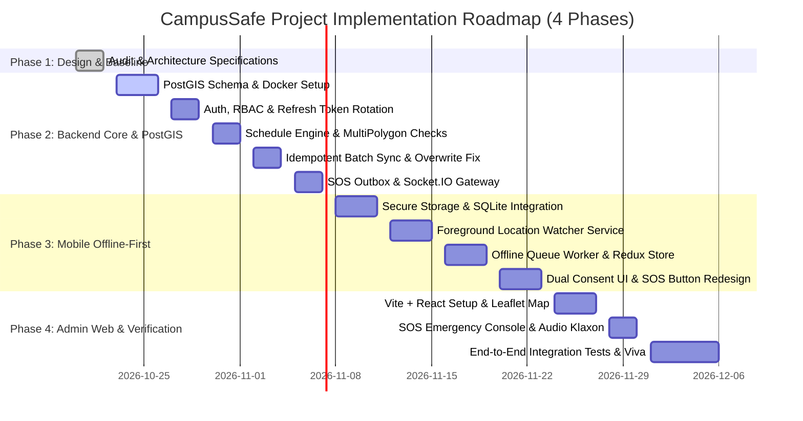

# CampusSafe: Phased Implementation Plan & Technical Roadmap

**Project:** CampusSafe: An Offline-First Student Safety and Campus Geofencing System  
**Academic Target:** MCA Final-Year Capstone Project  
**Author:** Senior React Native Engineer & Backend Architect  
**Version:** 1.0.0  
**Specification Status:** Phase 2 Backend Implementation Completed & Verified  

---

## 1. Incremental Execution Strategy

To eliminate regression risks and prevent disruptive rewrites, CampusSafe utilizes an incremental multi-tier repository structure:
- **Root Directory (`./`):** Retains the existing, verified React Native CLI mobile application (RN 0.87.1, New Architecture, Hermes). Reuses existing mathematical distance algorithms (`src/utils/distance.js`), design tokens (`src/constants/colors.js`), separate StyleSheet patterns, and bootsplash animations.
- **Backend Directory (`backend/`):** Houses the standalone Node.js + TypeScript service powering PostgreSQL 16 / PostGIS 3.4 spatial logic, REST synchronization endpoints, transactional notification outbox, and Socket.IO real-time channels.
- **Admin Dashboard Directory (`admin/`):** Houses the administrative React + Vite + TypeScript web console for security personnel, interactive PostGIS campus mapping, and SOS monitoring.
- **Shared Types Directory (`shared/types/`):** Holds pure TypeScript data contracts shared between backend and administrative frontend.

---

## 2. Four-Phase Master Implementation Roadmap

---

## 3. Detailed Phase Breakdown

### Phase 1: Audit, Baseline Verification & Architectural Blueprint (Completed)
- [x] Inspect existing React Native CLI codebase, toolchain (RN 0.87.1, React 19.2.3, Hermes, New Architecture).
- [x] Verify existing Jest unit tests passing (7 tests passing across 2 test suites; code coverage baseline documented as unmeasured).
- [x] Verify native configuration for Android (Target SDK 36, compileSdk 37) and iOS (`Podfile`, `Info.plist`).
- [x] Formulate technical specifications, threat model, PostGIS schema, API contracts, and queue protocols.
- [x] Resolve all implementation-blocking architectural inconsistencies across all documentation.

---

### Phase 2: Backend Core, PostGIS Foundation & Real-Time Services (Completed & Verified)
*Goal: Construct the authoritative PostgreSQL + PostGIS cloud backend, authentication subsystem, outbox worker, and real-time WebSocket cluster.*

- [x] **Database & Infrastructure Setup:**
   - Created `backend/docker-compose.yml` for local PostgreSQL 16 + PostGIS 3.4 (`postgis/postgis:16-3.4`).
   - Run complete relational DDL migrations (`001_initial_schema.sql`):
     - `users`, `refresh_tokens`, `campuses`, `student_campus_memberships`, `admin_campus_assignments`
     - `monitoring_schedules`, `guardian_links`, `guardian_consent_events`
     - `safety_sessions`, `location_records`, `student_current_locations`, `safety_events`
     - `sos_requests`, `notification_outbox`, `access_audit_logs`
   - Added dual-mode spatial calculation (PostGIS SQL functions with pure TypeScript WGS84 ray-casting & Haversine buffer calculation).
   - Seeded multi-tenant test campuses (`CSEU` and `MPI`), students (`ACTIVE` and `PENDING_APPROVAL`), guardians, and safety admins.
   - Provided controlled CLI admin provisioning workflow (`src/db/seedAdminCli.ts`).
- [x] **Authentication & Campus Authorization Engine:**
   - Implemented user login resolving role server-side (no client role assignment).
   - Implemented student self-registration defaulting to `PENDING_APPROVAL` status (entering roll number does not grant verified membership).
   - Implemented refresh token persistence, hashing, expiry, family rotation, and replay attack detection.
   - Implemented authorization middleware verifying:
     - Student campus membership (`student_campus_memberships`)
     - Admin campus assignments (`admin_campus_assignments`)
     - Guardian link consent and revocation
- [x] **Schedule & Timezone Gating Engine:**
   - Timezone-aware schedule validator checking campus local time against `monitoring_schedules` via Luxon.
   - Enforce rule: Reject session activation requests outside active college hours with HTTP 403 `OUTSIDE_MONITORING_HOURS`.
   - Single active session per student strictly enforced.
   - Automatic session expiry independent of network silence.
- [x] **Idempotent Batch Synchronization & Atomic Upsert:**
   - Implemented `POST /api/v1/sessions/:id/locations/batch` with payload validation via Zod (bounded max 100 points).
   - Validated timestamp boundaries (reject `captured_at` > 5 mins in future or older than session start).
   - Enforced conflict matrix: returned per-point results (`ACCEPTED`, `DUPLICATE`, `REJECTED`).
   - Implemented atomic conditional upsert on `student_current_locations` ensuring delayed historical points from older sessions never overwrite active coordinates.
   - Historical records (> 120s old) accepted into `location_records` without triggering misleading real-time alerts.
- [x] **Emergency SOS & Transactional Outbox Worker:**
   - Implemented `POST /api/v1/sos` persisting SOS and `notification_outbox` in a single atomic transaction with status `RECEIVED`.
   - Supported nullable coordinates and out-of-session SOS routing to student's campus safety desk.
   - Background outbox worker claiming jobs with `FOR UPDATE SKIP LOCKED`, mock notification dispatch, and delivery tracking.
   - Concurrency-safe SOS claim endpoint (`POST /sos/:id/acknowledge`) using atomic conditional update.
   - Resolution endpoint with mandatory resolution notes (`POST /sos/:id/resolve`).
- [x] **Socket.IO Gateway:**
   - Set up WebSocket server with JWT authentication handshake.
   - Implemented namespaces: `/dashboard` (scoped by campus) and `/guardian` (scoped by student).
   - Real-time event broadcasting (`location_update`, `sos_received`, `sos_acknowledged`, `sos_resolved`, `consent_revoked`).
- [x] **Automated Backend Integration Test Suite:**
   - Executed 30/30 integration tests across 7 test suites against real test database `campussafe_test`:
     - Cross-campus and cross-student access denial (`authorization.test.ts`)
     - Guardian invitation replay and access revocation (`guardian.test.ts`)
     - Refresh rotation and replay detection (`auth.test.ts`)
     - Duplicate/conflicting location uploads (`sync.test.ts`)
     - Concurrent and out-of-order uploads across sessions (`sync.test.ts`)
     - Offline history uploaded after session end (`sync.test.ts`)
     - Schedule boundaries and session expiry (`schedule.test.ts`)
     - SOS retries, nullable location, concurrent acknowledgement, and outbox recovery (`sos.test.ts`)
     - Unauthorized sockets and revocation of existing subscriptions (`socket.test.ts`)

---

### Phase 3: Mobile Offline-First Engine, Secure Storage & Foreground Watcher
*Goal: Transform the standalone attendance app into an offline-first student safety client.*

1. **Secure Storage & Local SQLite Migration:**
   - Install `react-native-encrypted-storage` for storing JWT access and refresh tokens.
   - Install `@op-engineering/op-sqlite` (v18.2.5) and compile with New Architecture TurboModules.
   - Initialize local database tables: `local_sessions`, `location_queue`, `local_events_queue`, `local_sos_queue`, `offline_config`.
   - Implement crash recovery routine on startup: reset stranded `SYNCING` records to `PENDING`.
2. **Android Foreground Location Watcher:**
   - Update `AndroidManifest.xml` with `FOREGROUND_SERVICE`, `FOREGROUND_SERVICE_LOCATION`, `POST_NOTIFICATIONS`.
   - Configure continuous GPS tracking using `react-native-geolocation-service` with a persistent status bar notification (*"CampusSafe Active: Safeguarding your campus transit"*).
   - Implement accuracy gating: discard or flag fixes with accuracy $> 50\text{ meters}$.
3. **Offline Upload Queue Worker & State Integration:**
   - Install `@reduxjs/toolkit` and `react-redux` (v9).
   - Implement background sync worker listening to `@react-native-community/netinfo`.
   - Implement FIFO queue pruning when queue reaches 10,000 points while protecting SOS and safety events.
   - Parse server per-point `results` array; mark records `SYNCED` only upon explicit acknowledgment.
   - Retain synced points for 7 days in SQLite for local student history display.
4. **Safety Desk UI & SOS Redesign:**
   - Redesign `AttendanceScreen.js` into **SafetyDeskScreen**:
     - Visualizes multi-point campus MultiPolygon and 20m buffer.
     - Dynamic status pills: 🟢 Inside Campus, 🟠 Buffer Warning, 🔴 Outside Campus.
     - Prominent 1-Tap Emergency SOS Trigger writing immediately to local SQLite without waiting for GPS fix.
     - Preserves interviewer simulation pills (`Live GPS`, `Campus Interior`, `Buffer Zone`, `Outside Campus`) for viva demonstrations.
   - Dual-level consent toggles for university safety and guardian sharing.

---

### Phase 4: Administrative Web Console, Integration Testing & Capstone Verification
*Goal: Construct the desktop web console, verify end-to-end integration, and package the capstone project.*

1. **Web Console Scaffolding:**
   - Initialize `/admin` with React 19, TypeScript, and Vite.
   - Implement clean slate/blue/emerald dashboard theme matching mobile design tokens.
2. **Interactive PostGIS Campus Map:**
   - Integrate Leaflet / MapLibre to render campus MultiPolygon boundaries and 20m buffer zones.
   - Render student markers with color-coded freshness indicators:
     - 🟢 Pulsing Green: Fresh (< 2 mins).
     - 🟡 Solid Amber: Stale (2–15 mins).
     - ⚪ Hollow Gray: Offline / Disconnected (> 15 mins).
3. **Live Telemetry & Emergency SOS Response Desk:**
   - Connect to `/dashboard` and `/sos-channel` Socket.IO namespaces.
   - Audible klaxon and emergency modal when an SOS alert is received.
   - Claim/acknowledge incident workflow with responder assignment.
   - Resolution modal capturing mandatory incident notes.
   - Reconnecting console recovery via `GET /api/v1/sos/active?campusId=...`.
4. **Audit Trail Inspector:**
   - Administrative search and filtering of `access_audit_logs`.
5. **End-to-End System Verification:**
   - Full simulated transit test: start session, record fixes inside campus, cross buffer zone, trigger exit dwell, simulate offline mode, queue 50 points, restore network, verify idempotent ingestion.
   - SOS trigger test: dispatch emergency without active session; verify instant desktop alert.
6. **Academic Capstone Deliverables:**
   - Comprehensive MCA project dissertation and technical documentation.

---

## 4. Android-First MVP Scope vs. iOS Support Blueprint

To maintain academic engineering realism for an MCA capstone, the project designates **Android as the Primary Implementation Target**, while providing a complete **Architectural Blueprint for iOS**.

### 4.1 Android-First Implementation Rationale
1. **Toolchain Accessibility:** Native Android build tools and emulators with Google Play Services run out-of-the-box on standard development machines without requiring paid Apple Developer accounts.
2. **Foreground Service Control:** Android explicitly permits long-running location tracking when accompanied by an ongoing user-visible notification (`FOREGROUND_SERVICE_LOCATION`), making background offline-first telemetry reliable and testable.
3. **Target SDK 36 Compatibility:** The project is already configured for Android 14–16 (`targetSdk: 36`, `compileSdk: 37`), ensuring the implementation adheres to the latest Android location privacy standards.

### 4.2 iOS Architectural Blueprint (Documented Feasibility)
While not targeted for primary physical testing, CampusSafe is architecturally designed for iOS compatibility:
- **Permissions Required (`Info.plist`):**
  - `NSLocationWhenInUseUsageDescription`: Required for foreground tracking.
  - `NSLocationAlwaysAndWhenInUseUsageDescription`: Required if background location is enabled.
- **Background Modes (`UIBackgroundModes`):** Must include `location` and `fetch`.
- **CoreLocation Differences:**
  - Unlike Android's explicit foreground service, iOS manages background execution aggressively. When an app enters the background, iOS CoreLocation continues streaming fixes only if `showsBackgroundLocationIndicator = true` and `allowsBackgroundLocationUpdates = true`.
  - For long-term battery conservation, iOS apps must transition to the **Significant Location Change Service** (cell tower triangulation) rather than continuous GPS polling.
- **App Store Privacy Constraints:** Apple App Store review requires strict justifications for `Location Always` permissions. CampusSafe's consent-first session lifecycle and user-facing emergency purpose align with Apple's Safety & Location guidelines.

---

## 5. Concise Audit Summary & Key Architectural Decisions

1. **Audit Summary:**
   - Existing repository has a clean, high-performance foundation built on React Native CLI 0.87.1, React 19.2.3, Hermes, and the New Architecture (`newArchEnabled=true`).
   - Existing unit tests (`npm test`) pass with 100% success (7 tests passing; code coverage unmeasured).
   - Core mathematical functions (`src/utils/distance.js`) and UI design tokens (`src/constants/colors.js`) are directly reusable.
   - Missing: Backend server, PostGIS spatial queries, persistent SQLite mobile storage, background service, user authentication, and admin web dashboard.
2. **Key Architectural Decisions (ADRs):**
   - **Retain Root Mobile App:** Do not rewrite or restructure the mobile root; add `backend/` and `admin/` incrementally.
   - **Adopt `@op-engineering/op-sqlite`:** Chosen for native React Native 0.87 New Architecture TurboModule compatibility.
   - **Database Authoritative Pattern:** All state writes go through PostgreSQL transactions; Socket.IO is strictly an event distribution layer.
   - **Materialized Current Location Pattern:** Solves the out-of-order delayed upload overwrite vulnerability via atomic conditional SQL upsert.
   - **Restrictive Schedule Gate:** College hours solely restrict tracking; they never trigger autonomous monitoring without student consent.
   - **Decoupled Offline Sessions:** Sessions remain active on disconnected devices until schedule end or manual stop; no arbitrary 30-minute inactivity auto-expiry.

---

## 6. Open Blockers & Decisions for User Confirmation

Before commencing implementation in Phase 2, the following configuration choices should be noted:
1. **SMS Gateway:** For physical production, an external SMS service (e.g. Twilio or MSG91) is needed to notify guardians. For the MCA demonstration, an internal logging webhook / mock SMS logger is planned.
2. **Campus MultiPolygon Coordinates:** The default test seed will use the Chandigarh Technology Park / University campus grounds unless custom coordinates are specified.
3. **Database Hosting:** Dockerized local PostgreSQL 16 with PostGIS 3.4 will be used for local development and demonstration.

---

## 7. Actionable Checklist for Phase 2 Commencement

When authorized to begin Phase 2 (Backend Core, PostGIS Foundation & Real-Time Services), execution will follow this checklist:

- [ ] **Step 2.1:** Create `backend/` directory with `package.json`, `tsconfig.json`, and initial project dependencies (`express`, `pg`, `socket.io`, `zod`, `dotenv`, `cors`, `bcrypt`, `jsonwebtoken`).
- [ ] **Step 2.2:** Create Docker Compose configuration for local PostgreSQL 16 + PostGIS 3.4.
- [ ] **Step 2.3:** Execute SQL migration scripts establishing the complete relational schema defined in `docs/DATA_MODEL.md` including memberships, assignments, refresh tokens, and outbox tables.
- [ ] **Step 2.4:** Implement authentication service (JWT, bcrypt, student/guardian registration, login without client role parameter, refresh token family rotation, logout).
- [ ] **Step 2.5:** Implement campus management endpoints and PostGIS MultiPolygon geofencing queries (`ST_Contains`, `ST_Buffer`) with versioning.
- [ ] **Step 2.6:** Implement schedule validation engine enforcing campus operating hours.
- [ ] **Step 2.7:** Implement idempotent batch sync endpoint (`POST /sessions/:id/locations/batch`) with per-point result responses and atomic latest-location upsert.
- [ ] **Step 2.8:** Implement SOS dispatch, transactional outbox worker, and incident lifecycle endpoints.
- [ ] **Step 2.9:** Implement Socket.IO real-time server with authenticated namespaces (`/dashboard`, `/sos-channel`, `/guardian`).
- [ ] **Step 2.10:** Write automated backend integration tests validating batch synchronization and out-of-order protections.
