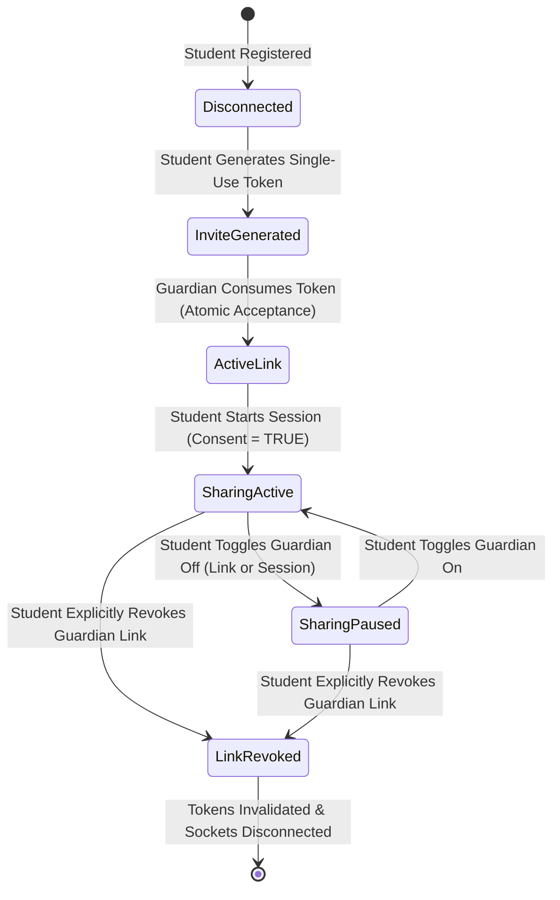

# CampusSafe: Project Scope & Operational Boundaries

**Project Name:** CampusSafe: An Offline-First Student Safety and Campus Geofencing System  
**Academic Context:** Master of Computer Applications (MCA) Final-Year Capstone Project  
**Target Platform:** Android-First (React Native CLI 0.87.1, New Architecture / Hermes) with iOS Architecture Blueprint  
**System Class:** Safety Assistance Prototype (Non-Commercial / Non-Guaranteed Emergency SLA)  
**Specification Status:** Ready for Phase 2 implementation  

---

## 1. Executive Summary & Vision

University campuses in India and globally encompass sprawling multi-acre grounds with multiple academic blocks, hostels, research labs, sports complexes, and transit zones. While physical boundary checkpoints exist, student safety during evening hours, off-campus excursions, and transit between facilities remains an important operational concern.

**CampusSafe** is an offline-first student safety and campus geofencing system designed to bridge the gap between individual student privacy and institutional duty of care. Unlike invasive commercial tracker apps or punitive surveillance software:
1. **Consent is Paramount:** Location recording is strictly opt-in and student-initiated. No university administrator or guardian can remotely activate tracking or monitor a student without an active, student-initiated safety session.
2. **Schedule Restricts, Never Initiates:** Configured college hours (e.g., 08:30–17:30 in the campus timezone, e.g. `Asia/Kolkata`) act solely as a strict temporal boundary. If a student attempts to activate tracking outside college hours, the request is rejected. When the clock strikes the end of configured college hours, an active session is automatically expired. Under no circumstances does the system silently activate tracking simply because a schedule has started.
3. **Decoupled Offline Sessions & Server Contact:** A student's safety session does **not** expire merely because network connectivity is lost or telemetry has not been received by the server for 30 minutes. An authorized, active session continues recording telemetry into local SQLite storage until its scheduled expiration time or until the student explicitly taps "Stop Session". Server contact freshness (`FRESH`, `STALE`, `UNKNOWN`) is strictly decoupled from the session lifecycle.
4. **Delayed Upload Acceptance:** The server accepts delayed offline location batches uploaded after a session has ended or expired, provided the points were captured during the valid, consented session window. Such delayed uploads populate historical audit logs and do not re-open the ended session.
5. **Connectivity Requirement for New Sessions (MVP):** For the MVP, starting a **new** safety session requires network connectivity to validate student-campus membership, verify active schedule hours, confirm boundary versions, and obtain a cryptographically signed session lease from the server.
6. **Transparent Role Boundaries & Campus Authorization:** The system strictly separates three roles—`STUDENT`, `GUARDIAN`, and `UNIVERSITY_SAFETY_ADMIN`—and explicitly forbids unrestricted peer-to-peer or classmate-to-classmate tracking. Roles alone are never sufficient for authorization: actions require explicit campus membership (`student_campus_memberships`) or campus assignment (`admin_campus_assignments`).

---

## 2. Core System Roles & Authorization Matrix

The system enforces strict Multi-Tenant Role-Based Access Control (RBAC) backed by cryptographically signed JWT tokens, role guards, campus membership/assignment checks, and student consent grants:

| Capability / Action | `STUDENT` | `GUARDIAN` | `UNIVERSITY_SAFETY_ADMIN` | `CLASSMATE / PEER` |
| :--- | :---: | :---: | :---: | :---: |
| **Start / Stop Safety Session** | **Full Control** (Self; requires campus membership) | ❌ Denied | ❌ Denied (Cannot remotely start/stop) | ❌ Denied |
| **Trigger Emergency SOS** | **Full Control** (1-Tap, anytime) | ❌ Denied | ❌ Denied | ❌ Denied |
| **View Live Location** | **Full Control** (Self) | **Conditional** (Only if active session + active link + session guardian consent) | **Conditional** (Only if active session + campus assignment + university consent) | ❌ **Strictly Prohibited** |
| **View Historical Breadcrumbs** | **Full Control** (Self) | **Conditional** (Only approved sessions during valid link window) | **Audit-Logged** (Only for assigned campus & incident investigations) | ❌ **Strictly Prohibited** |
| **Manage Campus Boundaries & Schedules** | ❌ Denied | ❌ Denied | **Conditional** (Only for assigned campuses) | ❌ Denied |
| **Acknowledge & Resolve SOS Incidents** | View self status | View ward status | **Full Control** (Assigned campus security officers) | ❌ Denied |
| **Invite / Revoke Guardians** | **Full Control** (Generates token/link) | ❌ Denied | ❌ Denied | ❌ Denied |
| **Inspect Access Audit Logs** | View own access history | ❌ Denied | Assigned campus audit log view | ❌ Denied |

### Role & Account Provisioning Rules

1. **`STUDENT` (Mobile App User):**
   - Enrolled university student equipped with an Android (or iOS) smartphone.
   - Self-registration captures institutional email and roll number. **Entering a roll number does not grant automatic verified campus membership.** New student accounts remain in `PENDING_APPROVAL` status until verified by campus safety administration, or students utilize pre-seeded verified accounts for the MCA MVP evaluation.
   - Must belong to an active, verified `student_campus_memberships` record to activate sessions on that campus.
   - Holds unilateral authority over starting, pausing, and ending safety sessions.
   - Can grant or revoke university safety access and per-guardian viewing access at any moment.

2. **`GUARDIAN` (Parent / Designated Emergency Contact):**
   - Linked to a specific student via a cryptographically random, single-use, hashed invitation token generated by the student.
   - Can only view the ward's current coordinates while a safety session is explicitly active and guardian sharing is toggled ON at both the link and session levels.
   - Receives emergency notifications if the student triggers SOS or exits campus during an active session.
   - Has zero visibility into other students, campus operations, or institutional telemetry.

3. **`UNIVERSITY_SAFETY_ADMIN` (Campus Security & Proctorial Office):**
   - Verified campus security personnel operating from the administrative web console.
   - **No Public Self-Registration:** Privileged safety admin accounts **cannot** be registered publicly. They are provisioned exclusively through a controlled seed script or backend administrative CLI command (`npm run seed:admin`).
   - Must have an active `admin_campus_assignments` record for each campus they monitor. An admin assigned to Campus A has zero access to Campus B.
   - Monitors a live PostGIS-powered campus map showing active safety sessions, freshness status, and boundary alarms.
   - Every lookup or historical review is permanently written to an append-only `access_audit_logs` table.

4. **Classmate / Peer Restriction:**
   - Under no circumstances does CampusSafe provide "find my friend" or social classmate location feeds. Classmate tracking introduces severe risks of stalking, peer coercion, and social surveillance that run counter to student safety.

---

## 3. Consent Architecture & Guardian Lifecycle

### 3.1 Invitation & Verification Protocol (Token-Based, No Mandatory SMS)
1. A student generates an invitation in the mobile app. The server creates an invitation token, stores its cryptographic hash (`token_hash`) in `guardian_links`, sets `status = 'PENDING'`, and sets a 24-hour expiration timestamp.
2. The raw token is returned once to the student, who shares it directly with their guardian via secure messaging, QR code, or direct deep link (`campussafe://guardians/join?token=...`).
3. To avoid mandatory third-party paid SMS gateways during academic evaluation, acceptance is authenticated purely via this secure token.
4. The guardian enters the token and student roll number. The server executes an **atomic single-use transaction** (`SELECT ... FOR UPDATE` or conditional status update) verifying the hash, ensuring status is `PENDING`, marking it `ACCEPTED`, recording `consumed_at`, and linking the guardian's user ID.

### 3.2 Granular Dual-Level Sharing Controls
Guardian location sharing requires two concurrent consent layers:
1. **Link-Level Consent (`guardian_links.consent_granted`):** The student can toggle sharing on or off for a specific guardian at any time via `PATCH /api/v1/guardians/:linkId/consent`.
2. **Session-Level Consent (`safety_sessions.consent_guardians`):** When starting or running a session, the student can globally toggle guardian visibility via `PATCH /api/v1/sessions/:id/consent`.
- Both must be `true` for a guardian to receive live telemetry.

### 3.3 Instant Revocation & Disconnected Device Limitations
- When a student revokes a guardian link:
  1. The server updates `guardian_links.status = 'REVOKED'` and sets `revoked_at`.
  2. The guardian's active WebSocket room subscription is instantly terminated (`socket.leave("ward-{student_id}")`).
  3. Cached access tokens for that relationship are evicted from server cache.
  4. Subsequent REST requests by the guardian return `403 Forbidden (Consent Revoked)`.
- **Disconnected Device Realism:** If the student's mobile device is offline when a revocation occurs (e.g. revoked via student web portal), the phone will continue recording locally until it synchronizes. However, the server immediately denies all guardian requests and drops guardian socket broadcasts at the network boundary.

### 3.4 Historical Visibility
- Guardians can only view historical breadcrumbs for sessions that occurred while their link was in `ACTIVE` status and for which session-level guardian consent was enabled.
- Once a link is revoked, the guardian cannot view subsequent sessions. Access to prior session history is restricted to the university's standard retention window (default: 30 days) and logged in `access_audit_logs`.

---

## 4. Operating Schedules & Campus Timezones

### 4.1 Restrictive Gating Principle
CampusSafe adheres strictly to the **Restrictive Schedule Gate Principle**:
$$\text{SessionStartPermitted} \iff \text{StudentConsent} \land \text{InsideActiveSchedule} \land \text{ValidCampusMembership}$$

- **No Silent Activation:** If campus hours are configured from 08:30 to 17:30 in the campus timezone (`Asia/Kolkata`), the mobile app will **never** wake up at 08:30 to begin tracking automatically. Only an explicit user action (`Start Safety Session`) can initiate a session.
- **Out-of-Hours Hard Stop:** An active session automatically transitions to `EXPIRED` when the configured college hours end. A local notification alerts the student: *"College hours have concluded. Safety tracking session #SESS-102 has automatically ended."*
- **Timezone Normalization:** All campus boundaries and operating schedules define an explicit IANA Timezone string (e.g., `Asia/Kolkata`). Backend validations convert client UTC timestamps to campus local wall-clock time before assessing schedule constraints.

---

## 5. Campus Geofence, Buffers & Exit Handling

### 5.1 Geofence Topology: MultiPolygon Support
- University campuses often include disjoint parcels, research parks, hostels, and medical wings separated by municipal public roads.
- CampusSafe represents campus boundaries as **PostGIS MultiPolygon geometries (`GEOMETRY(MultiPolygon, 4326)`)**. Every polygon ring is explicitly closed and validated.
- Boundaries carry an integer `boundary_version`. When safety administrators alter perimeter geometries, the version is incremented. Safety sessions record the `boundary_version` active at the time of tracking.

### 5.2 Deterministic Boundary Evaluation Rule
To prevent GPS jitter from generating false boundary alarms, boundary evaluation adheres to a deterministic rule:
- **Perimeter Buffer Zone:** A configurable hysteresis buffer (default: 20 meters) is applied outward using `ST_Buffer`.
- **States:**
  - `INSIDE_CORE`: Coordinate lies within the core campus MultiPolygon.
  - `BUFFER_ZONE`: Coordinate lies outside core but within the 20-meter buffer. Mobile app shows warning pill: *"Approaching campus boundary"*.
  - `OUTSIDE_CAMPUS`: Coordinate lies outside both core and buffer.
- **Configurable Exit Rule:** A `CAMPUS_EXIT` event is triggered **only** when all of the following conditions are met:
  1. Minimum continuous duration outside: at least **45 seconds** (`min_dwell_duration_seconds`).
  2. Minimum number of valid consecutive observations: at least **3 fixes** (`min_consecutive_observations`).
  3. Accuracy limit: each observation must have GPS accuracy $\le 50.0\text{ meters}$ (`max_accuracy_threshold`).
  4. Maximum observation gap: the time gap between consecutive observations must not exceed **30 seconds** (`max_observation_gap_seconds`). If a gap exceeds 30 seconds (due to app pause or signal loss), the dwell timer resets. A missing interval never counts as continuously observed dwell.

---

## 6. Emergency SOS Protocol

1. **Immediate Local Persistence Without GPS Fix:**
   - When the student triggers SOS, the action is **immediately** written to the local SQLite `local_sos_queue` with a client-generated `sos_uuid`.
   - The app does **not** block or wait for a fresh GPS fix. If fresh GPS is unavailable, the SOS record is stored with `coordinates = null` or populated with `last_known_coordinates` tagged with its `last_known_captured_at` and `accuracy`.
2. **Emergency Override & Out-of-Session Routing:**
   - SOS requests can be triggered at any time, including **outside configured college hours** and **without an active safety session**.
   - If triggered outside a session, the incident routes to safety administrators assigned to the student's primary enrolled campus (`student_campus_memberships`) and active guardians.
   - **No Silent Tracking Activation:** An out-of-session SOS transmits a point-in-time emergency distress snapshot. It does **not** silently start ongoing background location tracking.
3. **Rigorous SOS Semantics & State Pipeline:**
   - The system enforces a strict 4-stage lifecycle:
     - `LOCAL_PENDING`: Persisted on student phone in local SQLite, not yet accepted by server.
     - `RECEIVED`: Durably committed by the backend into PostgreSQL and transactional outbox.
     - `ACKNOWLEDGED`: Explicitly claimed by an authorized safety officer on duty for that campus via a concurrency-safe atomic update.
     - `RESOLVED`: Closed by an authorized safety officer with mandatory resolution report notes.
   - **Evidenced Delivery vs. Socket Emission:** Emitting a WebSocket event or recording a mock notification log is **not** treated as recipient delivery. Notification attempts (`DISPATCH_ATTEMPTED`) and evidenced recipient receipt (`RECIPIENT_CONFIRMED`) are tracked separately in `notification_outbox`.
4. **Transactional Outbox for Dispatch:**
   - The backend persists the SOS incident and corresponding notification jobs into a `notification_outbox` table within the **same atomic database transaction**, ensuring notifications are reliably processed by a retry worker even if the socket process crashes.

---

## 7. Storage-Pressure Policy (Mobile Offline Queue)

To prevent silent data loss during prolonged network disconnects:
1. **No Silent Purging:** Unacknowledged location records are **never** silently deleted when the queue reaches capacity (10,000 points).
2. **Recorded Data Gaps:** If storage pressure forces truncation of routine breadcrumbs, the mobile app writes a structured `TELEMETRY_GAP_RECORDED` event to `local_events_queue` documenting the gap interval (`gap_start`, `gap_end`, `dropped_count`).
3. **Emergency Reservation:** Emergency SOS records (`local_sos_queue`) and safety events (`local_events_queue`) are stored in isolated, protected tables and are **never** dropped under storage pressure.
4. **Visible Student Alert:** When storage pressure occurs, the mobile app displays an explicit, persistent warning banner: *"Local storage full: Offline location logging paused to preserve critical safety events. Connect to network to synchronize."*

---

## 7. Real-World Limitations & Prototype Disclaimers

> [!IMPORTANT]
> CampusSafe is an engineering capstone prototype designed to demonstrate offline-first distributed systems, PostGIS spatial queries, and consent-driven mobile architecture. It is **not** a certified emergency telecommunications system or legal university enforcement tool.

The system explicitly recognizes the following physical, technical, and operational constraints:

1. **Disconnected Remote Locations Are Impossible:**
   - An offline phone cannot transmit live telemetry across the internet. An offline student's location remains safely stored in local SQLite; the admin dashboard will display the location status as **UNKNOWN** or **STALE (Cached at HH:MM)** with an explicit offline badge. The system **never** portrays stale historical data as live.
2. **GPS Accuracy & Multipath Drift:**
   - GPS satellites require line-of-sight. In high-rise academic buildings, basements, or during heavy overcast weather, GPS accuracy degrades significantly (e.g., accuracy radius > 80m). Readings with accuracy worse than 50m are marked as `DEGRADED` and excluded from boundary exit triggers.
3. **OS Background Lifecycle Restrictions:**
   - Modern Android (Doze Mode, App Standby Buckets, OEM aggressive battery killers) and iOS (Background Execution Limits) can terminate background processes without notice. CampusSafe utilizes foreground services with persistent notifications on Android, but zero background termination cannot be mathematically guaranteed.
4. **Device Location $\neq$ Human Physical Presence:**
   - The device location proves only where the smartphone is. It does not prove the student did not lend their phone to a peer, leave it in a locker, or lose it.
5. **Campus Exit $\neq$ Misconduct or Classroom Absence:**
   - A student exiting the campus perimeter during class hours may be visiting an adjacent medical center, bank ATM, stationery store, or attending an off-campus seminar. The system classifies an exit as a safety notification, never as disciplinary evidence or proof of unauthorized absence.
6. **No Guaranteed Emergency SLA:**
   - CampusSafe does not replace official national emergency response channels (e.g., Dial 112 in India, 911 in North America). Students in life-threatening distress must contact official emergency services directly.

---

## 8. Data Retention & Access Audit Policy

1. **High-Resolution Breadcrumb Retention (Project Policy):**
   - High-frequency GPS breadcrumbs (sampled every 10–30 seconds) are stored in `location_records` for **30 days** as a project data retention policy, after which a scheduled PostgreSQL cron task purges them.
2. **Incident & SOS Log Retention (Project Policy):**
   - Verified SOS incident records, guard acknowledgments, and resolution reports are retained for **180 days** for project administrative review.
3. **Access Audit Trail & Database Protections:**
   - Every lookup of student location by an administrator or guardian is logged to `access_audit_logs`.
   - In production PostgreSQL, `access_audit_logs` is protected by revoking `UPDATE` and `DELETE` privileges from the application database user, enforcing append-only behavior at the SQL privilege level. Database superusers retain administrative recovery capabilities.

---

## 9. Capability Classification Matrix

| Feature / Subsystem | Status | Description |
| :--- | :---: | :--- |
| **Haversine Distance Calculation** | **Implemented** | Working pure JS utility in `src/utils/distance.js` with 100% test coverage. |
| **Foreground GPS Watcher** | **Implemented** | Working via `react-native-geolocation-service` in `AttendanceScreen.js`. |
| **Google Maps View & Circle Zone** | **Implemented** | Working interactive map in `react-native-maps` with satellite toggle. |
| **Interactive Test Simulation Controls** | **Implemented** | `Live GPS`, `Inside (28m)`, `Outside (245m)` demo mode pills. |
| **AsyncStorage JSON Storage** | **Implemented** | Legacy local record saving in `src/storage/attendanceStorage.js` (to be superseded by SQLite for telemetry). |
| **Separated StyleSheet Pattern** | **Implemented** | Clean modular CSS-in-JS style files and centralized color tokens. |
| **PostgreSQL + PostGIS Backend** | **Proposed (Phase 2)** | Node.js + TypeScript backend in `backend/` with relational spatial engine. |
| **Persistent SQLite Mobile Queue** | **Proposed (Phase 3)** | `@op-engineering/op-sqlite` table and robust offline upload queue. |
| **Explicit Consent & Safety Session Flow** | **Proposed (Phase 2/3)**| Student opt-in session lifecycle with start/stop and single-use token invitations. |
| **Operating Schedule & Timezone Gate** | **Proposed (Phase 2)** | Campus-specific schedule enforcement restricting session activation. |
| **Multi-Campus MultiPolygon Geofencing**| **Proposed (Phase 2)** | PostGIS MultiPolygon evaluation with 20m buffer and deterministic dwell rule. |
| **Emergency SOS Lifecycle & Outbox** | **Proposed (Phase 2/3)**| Mobile SOS button with transactional outbox, socket broadcast, and admin desk. |
| **React + TypeScript Admin Console** | **Proposed (Phase 4)** | Web dashboard in `admin/` showing real-time student markers and alerts. |
| **Android Foreground Service Notification** | **Proposed (Phase 3)** | Persistent notification ensuring continuous tracking when app is backgrounded. |
| **iOS Background Execution Parity** | **Unresolved** | Architectural blueprint documented; native parity requires Apple Developer Program enrollment and background execution entitlements. |
| **Production SMS Gateway Integration** | **Unresolved** | Third-party commercial SMS gateways (Twilio/MSG91) require paid credentials. Token-based direct flow and mock webhook dispatch used for MVP. |
